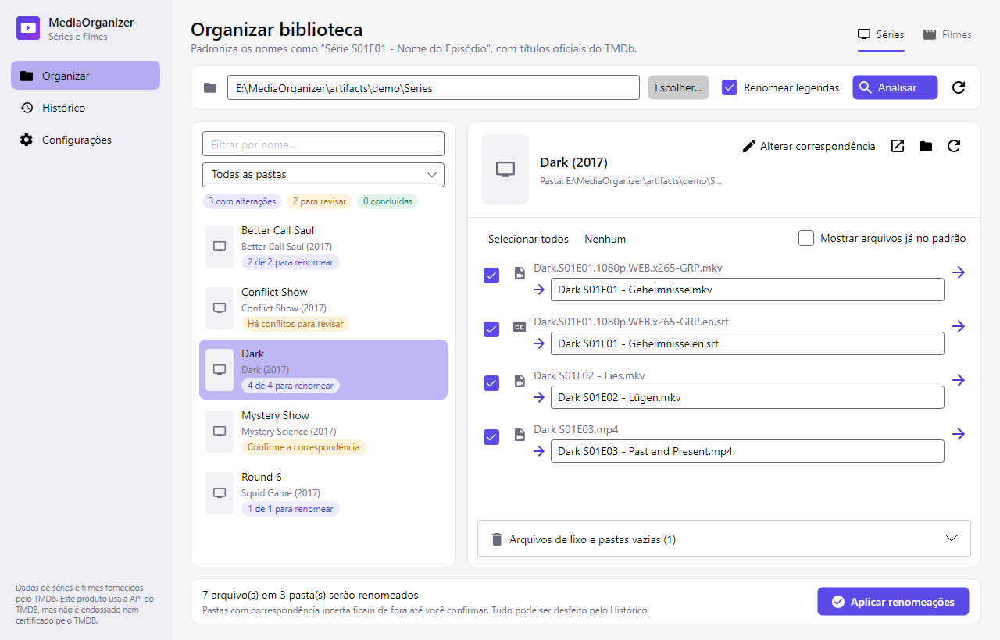
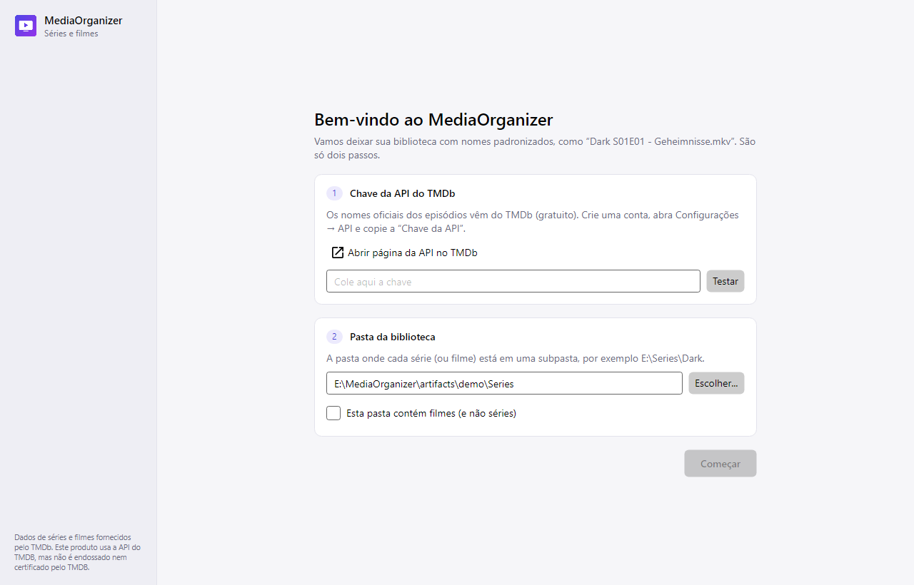
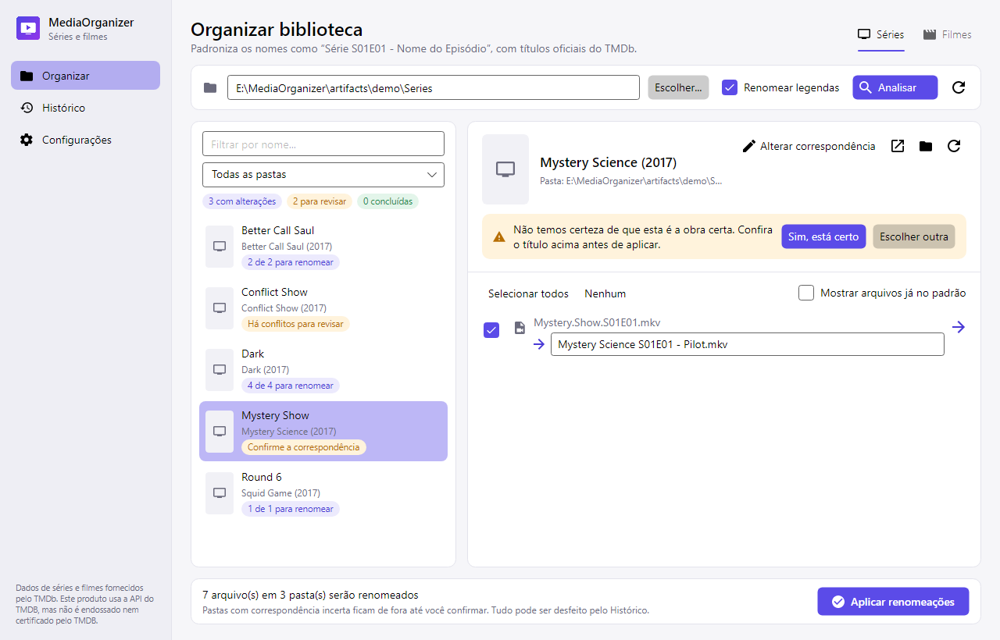
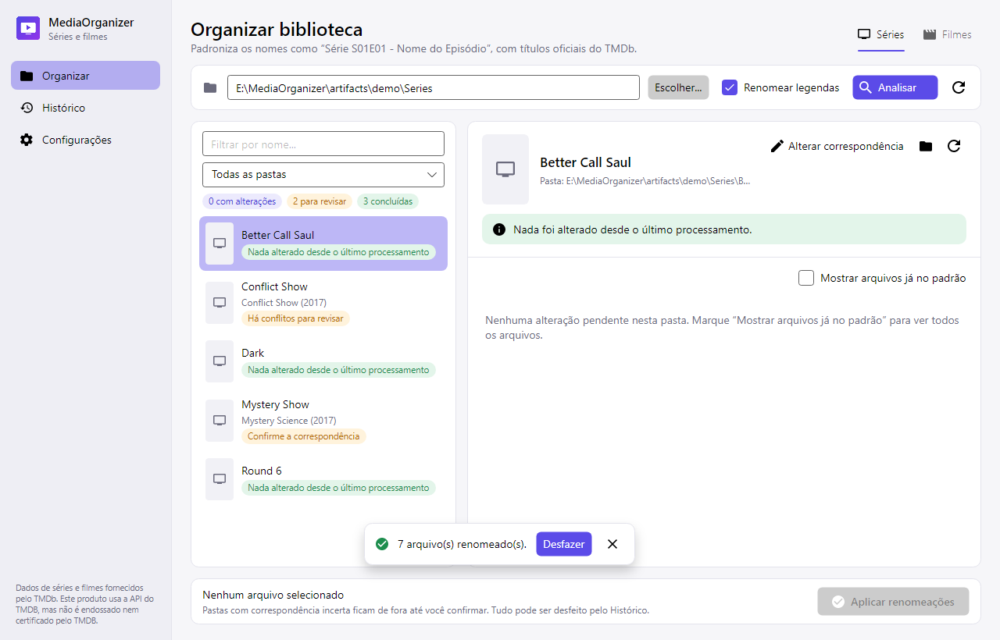

<p align="center">
  
</p>

<h1 align="center">MediaOrganizer</h1>

<p align="center">
  Organizador desktop de séries e filmes: padroniza os nomes dos arquivos com os títulos oficiais do TMDb.<br/>
  Windows · macOS · Linux — um único executável, sem instalar nada.
</p>

<p align="center">
  
  
  
  
</p>

<p align="center">
  
</p>

---

## O que ele faz

Transforma nomes de download como

```
Better.Call.Saul.S01E01.1080p.BluRay.x265-RARBG.mp4
Band of Brothers E01.mkv
Dark.S01E01.1080p.WEB.x265-GRP.en.srt
```

em

```
Better Call Saul S01E01 - Uno.mp4
Band of Brothers S01E01 - Currahee.mkv
Dark S01E01 - Geheimnisse.en.srt
```

seguindo o padrão **`[Nome da Série] SXXEXX - [Nome do Episódio].[extensão original]`**.

| Funcionalidade | Detalhes |
| --- | --- |
| **Nomes oficiais** | Série e episódios vêm do [TMDb](https://www.themoviedb.org/). Se o arquivo não tiver o nome do episódio, ele é buscado na internet. |
| **Idioma original** | Títulos no idioma original da obra (ex.: *Dark* em alemão). Para idiomas que não usam alfabeto latino (coreano, japonês...), usa o inglês (ex.: *Squid Game*). Nunca usa traduções. |
| **Prévia editável** | Nada é renomeado antes de você revisar. Cada novo nome pode ser editado e cada arquivo pode ser desmarcado. |
| **Desfazer** | Todo lote aplicado fica no **Histórico** e pode ser desfeito com um clique. |
| **Legendas** | `.srt`, `.ass`, `.vtt`... são renomeadas junto com o vídeo, com o código do idioma (`.en`, `.pt-BR`, `.forced`). Inclui o padrão `Subs/<release>/3_English.srt`. |
| **Subpastas preservadas** | Arquivos em subpastas (ex.: `Better.Call.Saul.S01.1080p.BluRay.x265-RARBG/`) são renomeados onde estão; nada é movido. |
| **"Nada foi alterado"** | O app guarda uma impressão digital (hash) de cada pasta processada. Se nenhum arquivo entrou ou saiu, a pasta não é reprocessada e você é avisado. |
| **Lixo de release** | Lista `RARBG.txt`, `PSArips.com.txt`, `.nfo`, pastas vazias... para enviar à **Lixeira** (nunca apaga definitivamente). |
| **Filmes** | Renomeia para `Filme (Ano)/Filme (Ano).ext`, criando a pasta quando o arquivo está solto. |
| **Conflitos** | Se dois arquivos ficariam com o mesmo nome, ou o nome já existe, a linha é bloqueada — nada é sobrescrito. |
| **Portátil** | Configurações e histórico ficam numa pasta `data/` ao lado do executável. |

## Download e uso

Baixe o executável do seu sistema na página de [Releases](../../releases) (ou gere você mesmo — veja [docs/BUILDING.md](docs/BUILDING.md)). Não é necessário instalar o .NET.

### Windows

1. Baixe `MediaOrganizer.exe` e coloque-o numa pasta de sua escolha (ex.: `C:\Apps\MediaOrganizer\`).
2. Dê dois cliques. Se aparecer o aviso do SmartScreen ("O Windows protegeu o computador"), clique em **Mais informações → Executar assim mesmo** (o executável não é assinado digitalmente).

### macOS

1. Baixe `MediaOrganizer-arm64.app` (Apple Silicon: M1/M2/M3/M4) ou `MediaOrganizer-x64.app` (Intel).
2. Mova para a pasta **Aplicativos**.
3. Na primeira vez, clique com o botão direito no app → **Abrir** → **Abrir**. Se o macOS disser que o app "está danificado", rode no Terminal:
   ```bash
   xattr -dr com.apple.quarantine /Applications/MediaOrganizer-arm64.app
   ```
4. Se o app não abrir após copiar de outro computador, restaure a permissão de execução:
   ```bash
   chmod +x /Applications/MediaOrganizer-arm64.app/Contents/MacOS/MediaOrganizer
   ```

### Linux

1. Instale as dependências gráficas (se ainda não tiver):
   - Debian/Ubuntu: `sudo apt install libx11-6 libice6 libsm6 libfontconfig1 libicu-dev`
   - Fedora: `sudo dnf install libX11 libICE libSM fontconfig libicu`
   - Arch: `sudo pacman -S libx11 libice libsm fontconfig icu`
2. Baixe `MediaOrganizer`, dê permissão de execução e rode:
   ```bash
   chmod +x MediaOrganizer
   ./MediaOrganizer
   ```

## Primeiros passos



1. **Crie uma API key gratuita do TMDb**
   1. Crie uma conta em [themoviedb.org](https://www.themoviedb.org/signup).
   2. Acesse **Configurações → API** ([link direto](https://www.themoviedb.org/settings/api)) e solicite uma chave (uso pessoal).
   3. Copie a **Chave da API** (v3) — ou o **Token de leitura da API** (v4); os dois funcionam.
2. Abra o MediaOrganizer, cole a chave, clique em **Testar** e escolha a pasta da biblioteca (ex.: `E:\Series`, onde cada série está em uma subpasta).
3. Na tela **Organizar**, clique em **Analisar** (ou `F5`).
4. Revise cada pasta à esquerda:
   - <kbd>4 de 4 para renomear</kbd> — pronta para aplicar.
   - <kbd>Confirme a correspondência</kbd> — o app não tem certeza da série; confira o título e clique em **Sim, está certo** ou **Escolher outra**.
   - <kbd>Há conflitos</kbd> — dois arquivos ficariam com o mesmo nome; edite um deles ou desmarque.
5. Clique em **Aplicar renomeações** (`Ctrl+Enter`). Para voltar atrás, use **Desfazer** na notificação ou na tela **Histórico**.



Na próxima vez que você analisar a mesma pasta, as séries que não mudaram aparecem como **"Nada alterado desde o último processamento"** e nem consultam a internet:



## Regras de nomeação (resumo)

- Formato: `Série SXXEXX - Título.ext`; vários episódios num arquivo: `Série S04E01-E02 - Título A & Título B.ext`.
- Minisséries sem temporada (`Band of Brothers E01`) viram `S01E01`.
- `.` e `_` dos nomes de download viram espaço; tags técnicas (`1080p`, `x265`, `WEBRip`, `-PSA`, `REPACK`...) são removidas.
- Título oficial sempre que existir no TMDb (corrige `REPACK`, `(1)`, `-The Red Woman`); se o TMDb não tiver o episódio, mantém o título do arquivo.
- Caracteres inválidos em Windows/macOS/Linux são tratados: `1:23:45` → `1.23.45`, `Monster: The Ed Gein Story` → `Monster - The Ed Gein Story`.
- Pastas `Extras`, `Featurettes`, `AudioBooks`, `Specials`... são ignoradas (configurável).

Especificação completa: [docs/SPEC.md](docs/SPEC.md).

## Onde ficam os dados

Tudo fica em `data/` **ao lado do executável** (no macOS, ao lado do `.app`), igual nos três sistemas:

| Arquivo | Conteúdo |
| --- | --- |
| `settings.json` | API key, pastas ignoradas, padrões de lixo, correspondências escolhidas |
| `processed.json` | Hash de cada pasta já processada ("nada foi alterado") |
| `history/*.json` | Lotes aplicados (usados para desfazer) |
| `cache/` | Respostas do TMDb (7 dias) |

Para usar outro local, defina a variável de ambiente `MEDIAORGANIZER_DATA`. Se a pasta do executável não puder ser gravada, o app usa a pasta de dados do usuário (`%AppData%\MediaOrganizer`, `~/Library/Application Support/MediaOrganizer` ou `~/.config/MediaOrganizer`).

## Perguntas frequentes

**A série foi identificada errada.** Selecione a pasta e clique em **Alterar correspondência**; busque pelo título (de preferência o original ou em inglês). A escolha fica salva.

**Um episódio ficou sem título.** O TMDb não tem esse episódio (ou a numeração difere). O arquivo é renomeado só com `SXXEXX` e aparece com um aviso; você pode digitar o título na prévia.

**Apareceu "Já existe um arquivo com este nome".** Há outro arquivo com o nome de destino (ex.: duas versões do mesmo episódio). Renomeie ou remova uma das cópias.

**Erro de permissão ao renomear.** Verifique se o arquivo não está aberto num player e se você tem permissão de escrita na pasta. Itens que falham ficam registrados no Histórico; o resto do lote é aplicado.

**Quero reprocessar tudo.** Use o botão ↻ ao lado de **Analisar** (reanalisa inclusive pastas sem alterações) ou **Configurações → Esquecer pastas processadas**.

## Documentação

- [docs/BUILDING.md](docs/BUILDING.md) — compilar, testar, rodar e gerar os executáveis em Windows, macOS e Linux.
- [docs/ARCHITECTURE.md](docs/ARCHITECTURE.md) — camadas e fluxo interno.
- [docs/SPEC.md](docs/SPEC.md) — especificação independente de linguagem (regras, formatos de arquivo, algoritmos).
- [docs/PORTING.md](docs/PORTING.md) — guia para reimplementar em Go ou Rust.
- [CONTRIBUTING.md](CONTRIBUTING.md) — como contribuir.
- [ROADMAP.md](ROADMAP.md) — próximas funcionalidades.

## Créditos

- Dados de séries e filmes: [TMDb](https://www.themoviedb.org/). *Este produto usa a API do TMDB, mas não é endossado nem certificado pelo TMDB.*
- Interface: [Avalonia UI](https://avaloniaui.net/) · ícones: [Material Design Icons](https://pictogrammers.com/library/mdi/) (Apache 2.0).

## Licença

[MIT](LICENSE)
